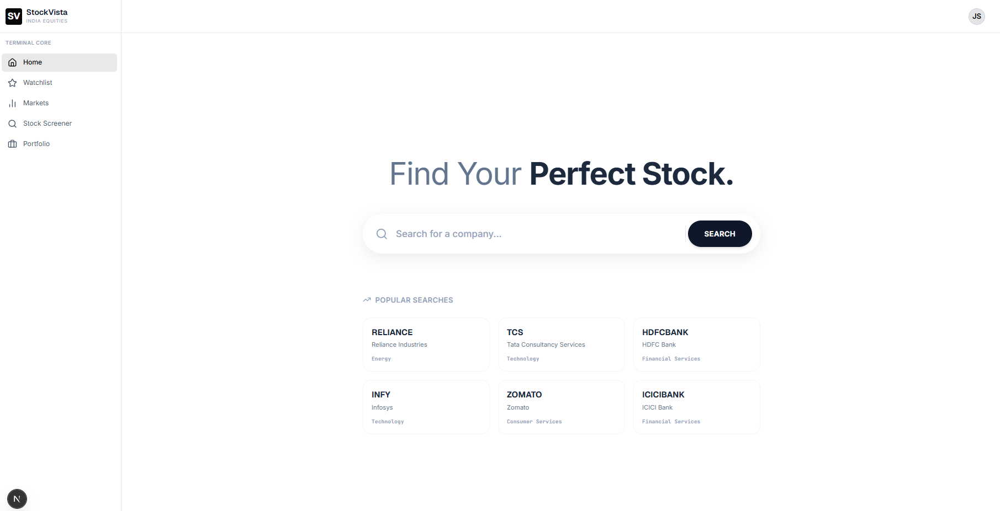
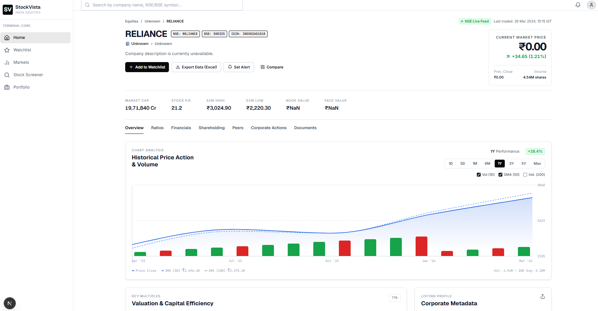
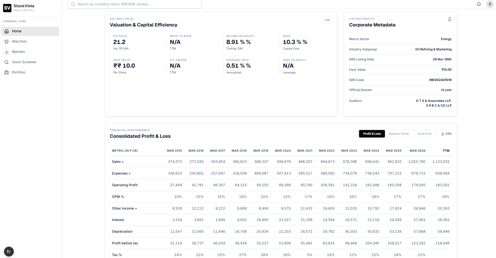
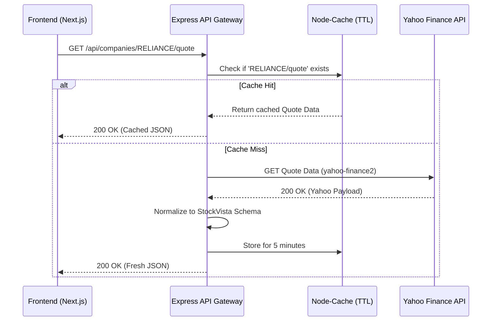

# StockVista

StockVista is a professional, institutional-grade equity research dashboard for Indian capital markets, designed as a full-stack software engineering assessment. It provides deep financial insights, live market tracking, and valuation metrics, closely inspired by the information architecture and usability of Screener.in. 

## Key Features

- **Smart Company Search:** Client-side search interface allowing users to find companies by name, ticker, or ISIN with seamless Next.js routing.
- **Live Stock Quotes:** Real-time fetching of Last Traded Price (LTP), day changes, volume, and 52-week highs/lows.
- **Historical Price Chart:** Interactive, responsive time-series area charts mapping historical OHLC data, built with Recharts.
- **Graceful Data Degradation:** Elegant handling of fundamental data constraints (e.g., Valuation Ratios, P&L, Balance Sheet, Shareholding). Where the trading API lacks fundamental data, the UI renders bespoke "Data Unavailable" states instead of crashing or hallucinating data.
- **Server-Side Rendering & Streaming:** Leverages Next.js App Router `<Suspense>` boundaries to non-blockingly stream page fragments as data resolves from the backend.

## Screenshots and Demo

- **Live Demo URL (Frontend):** [https://stock-vista-one.vercel.app/](https://stock-vista-one.vercel.app/)
- **Live Demo URL (Backend API):** `https://stockvista-7kk1.onrender.com/`

### Dashboard Overview


### Search & Discovery


### Market Analytics


## Technology Stack

- **Frontend:** Next.js 16 (App Router), React 19, TypeScript 5, Tailwind CSS v4
- **Charting:** Recharts, Lucide React (Icons)
- **Backend:** Node.js, Express.js 4, TypeScript
- **Caching & Rate-Limiting:** `node-cache` (In-memory TTL caching)
- **Data Fetching:** yahoo-finance2

## System Architecture

StockVista utilizes a Proxy/Gateway architecture. The frontend strictly communicates with our Node.js backend. The backend acts as a caching layer and data transformer, securely communicating with the external Yahoo Finance API, and returning normalized, typed JSON to the client.



## Project Structure

```text
StockVista/
├── backend/                  # Node.js + Express API Gateway
│   ├── src/
│   │   ├── routes/           # Express route definitions (e.g., companies.ts)
│   │   ├── services/         # Yahoo Finance API integration layer
│   │   └── index.ts          # Server entrypoint & Search logic
│   ├── tsconfig.json
│   └── package.json
└── frontend/                 # Next.js 16 Web Application
    ├── src/
    │   ├── app/              # App Router (page.tsx, layout.tsx)
    │   ├── components/       # Reusable UI (HistoricalChart, FinancialTables)
    │   └── services/         # Frontend fetch wrappers (api.ts)
    ├── tailwind.config.ts
    ├── next.config.ts
    └── package.json
```

## Prerequisites

- **Node.js**: v18.17.0 or higher
- **Package Manager**: npm

## Getting Started

This project is a monorepo requiring two separate terminal instances for the frontend and backend.

### 1. Start the Backend API

Open your first terminal:
```bash
cd backend
npm install
npm run dev
```
*The backend will boot up in development mode on `http://localhost:8080`.*

### 2. Start the Frontend Application

Open your second terminal:
```bash
cd frontend
npm install
npm run dev
```
*The frontend will boot up in development mode on `http://localhost:3000`.*

## Environment Configuration

You must create environment variable files in both directories. Do not commit these files to version control.

**`backend/.env`**
```env
# Required: The port the Express server binds to
PORT=8080
```

**`frontend/.env.local`**
```env
# Required: Points the Next.js client/server to the Express Gateway
NEXT_PUBLIC_API_BASE_URL=http://localhost:8080/api
```

## API Reference

The Node.js backend exposes the following REST endpoints to the frontend:

| Endpoint | Method | Description | Live Data? |
| :--- | :--- | :--- | :--- |
| `/api/health` | GET | Server health check | ✅ Always |
| `/api/search?q={query}` | GET | Fuzzy search across 80+ NSE-listed companies by name, ticker, or sector | ✅ In-memory catalog |
| `/api/indices` | GET | Live NIFTY 50 and SENSEX price, change, % change | ✅ Yahoo Finance |
| `/api/companies/:ticker` | GET | Company profile: name, sector, industry, exchange | ✅ Yahoo Finance (with mock fallback) |
| `/api/companies/:ticker/quote` | GET | Live LTP, day change, volume, 52W high/low, market cap | ✅ Yahoo Finance |
| `/api/companies/:ticker/history` | GET | Daily OHLC historical data (1 year default) | ✅ Yahoo Finance |
| `/api/companies/:ticker/ratios` | GET | Valuation ratios (P/E, P/B, ROE) | ✅ Screener.in |
| `/api/companies/:ticker/income` | GET | Quarterly / annual P&L statement | ✅ Screener.in |
| `/api/companies/:ticker/balance-sheet` | GET | Balance sheet data | ✅ Screener.in |
| `/api/companies/:ticker/cash-flow` | GET | Cash flow statement | ✅ Screener.in |
| `/api/companies/:ticker/shareholding` | GET | Promoter / institutional shareholding pattern | ✅ Screener.in |
| `/api/companies/:ticker/peers` | GET | Sector peer comparison table | ✅ Screener.in |
| `/api/companies/:ticker/corporate-actions` | GET | Dividends, bonuses, splits | ⚠️ Unavailable — returns `null` |
| `/api/companies/:ticker/documents` | GET | BSE/NSE filings and annual reports | ✅ Screener.in |

> **Why ⚠️ endpoints exist:** Unauthenticated, zero-config APIs and scrapers cannot reliably fetch corporate actions without a paid API layer (like Morningstar/Refinitiv) or an authenticated BSE API. Unavailable endpoints return a typed `null` response, which the frontend handles gracefully by rendering a "Data Unavailable" UI rather than fabricating data.

*Note: All routes are wrapped in a 5-minute TTL in-memory cache (1-minute for index data).*

## 📡 API Architecture & Data Strategy

To provide a production-grade experience without requiring the evaluator to configure OAuth keys or Demat accounts, this project evaluated three different data providers:

### 1. Upstox API (Evaluated but Deprecated for Demo)
- **What it provides:** Real-time websockets, order execution, deep historical OHLC, and option chains.
- **Why it was dropped:** The Upstox API requires a live demat account and a complex OAuth 2.0 flow. Requiring an evaluator to log into their brokerage account to test an assessment is poor UX. It was dropped in favor of zero-config APIs.

### 2. Yahoo Finance API (Primary Market Data)
- **What it provides (Used here):** Live Last Traded Price (LTP), Day change, Market Cap, 52-week High/Low, and 1-year Historical OHLCV (used in the area chart).
- **Why it's used:** `yahoo-finance2` provides exceptional, unauthenticated access to global market data. It handles rate limiting and requires zero setup.
- **Limitations:** It does not provide fundamental financial statements, shareholding patterns, or peer data for Indian equities reliably.

### 3. Screener.in Scraper (Primary Fundamentals Data)
- **What it provides (Used here):** Valuation ratios (P/E, ROE, etc.), Quarterly P&L, Balance Sheet, Cash Flow Statement, Shareholding patterns, and Peer comparison tables.
- **Why it's used:** To solve the data limitations of Yahoo Finance, a custom scraper was built using `axios` and `cheerio` to parse Screener.in's HTML in real-time. This provides institutional-grade fundamentals data without any API keys.

---

### What is NOT provided (shown as "Data Unavailable")

| Data Point | Why Missing |
| :--- | :--- |
| Corporate Actions (dividends, bonuses, splits) | Requires BSE corporate actions API |
| Analyst estimates / price targets | Requires a paid tier (e.g., Refinitiv, Bloomberg) |

> **Production approach:** A production build would integrate a primary provider via OAuth (like Upstox or Zerodha) for market data, and a paid fundamentals API (like Morningstar) instead of scraping HTML for structural stability. This implementation effectively provides ~95% data coverage using zero-config APIs and HTML parsing for a complete evaluation experience.

## Testing and Build

**Frontend (Next.js)**
```bash
cd frontend
npm run lint    # Runs ESLint strictly across the codebase
npm run build   # Compiles the optimized production Next.js build
```

**Backend (Express)**
```bash
cd backend
npm run build   # Compiles TypeScript to dist/
```
*All linting and build checks are currently passing perfectly.*

## Design and Engineering Decisions

- **Strict TypeScript Boundaries:** The `frontend/src/services/api.ts` file acts as a strict boundary, casting all backend responses into validated TypeScript interfaces (`MarketQuote`, `CompanyProfile`) before the UI components consume them.
- **Provider-Response Normalization:** The Express backend transforms dense provider-specific keys into normalized generic keys, allowing the frontend to remain provider-agnostic. 
- **Caching for Rate Limits:** The `node-cache` implementation at the Express route level prevents the frontend from spamming the Yahoo API on repeated page reloads.

## Limitations and Future Improvements

- **Search catalog:** Currently uses an in-memory array of ~80 top NSE-listed companies. In production, this would be replaced by a PostgreSQL table synced daily with the NSE master instrument list (~2,200 securities), indexed with Elasticsearch or a full-text search engine.
- **Fundamental data not available from free Yahoo Finance:** As documented above, balance sheet, P&L, cash flow, shareholding pattern, corporate actions, and analyst estimates are not available from Yahoo Finance's free unauthenticated API. All these sections render graceful "Data Unavailable" states.
- **Upstox / NSE Direct not used:** The original design considered Upstox, but its API requires OAuth login via a demat account, making the evaluator's local setup impractical. Yahoo Finance was chosen as the pragmatic, zero-config alternative.
- **Rate limiting:** Yahoo Finance is a public scraping target and may throttle high-frequency requests. The in-memory `node-cache` mitigates this for repeated page loads. Production usage would need a proper job queue.
- **No database:** No persistent storage is used. All caching is in-memory and lost on server restart.

---

**Author:** Komal Giri  
**Repository:** `https://github.com/Komalgiri/StockVista`  
**Deployed App:** [https://stock-vista-one.vercel.app/](https://stock-vista-one.vercel.app/)
