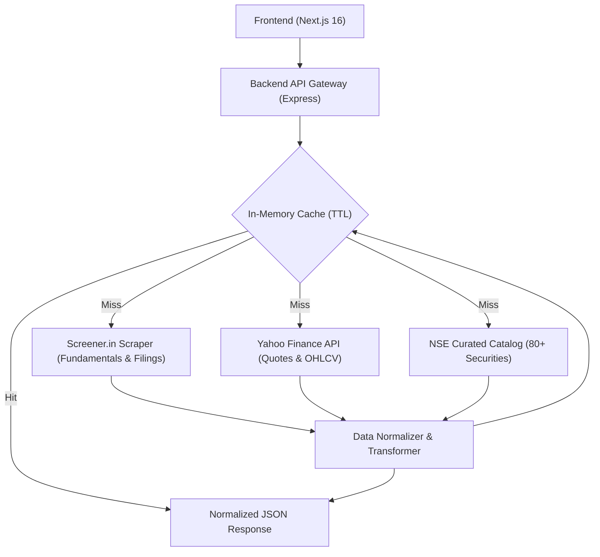

# StockVista

StockVista is an institutional-grade equity research and fundamental analysis dashboard for Indian capital markets, designed as a full-stack software engineering assessment inspired by **Screener.in**.

It combines multiple data providers (real-time scraping from Screener.in, live market data from Yahoo Finance, and an authoritative NSE equity catalog) to provide an authentic, end-to-end company research workflow for NSE/BSE-listed securities.

---

## 🚀 Live Demo & Repository

- **Frontend Application (Vercel):** [https://stock-vista-one.vercel.app/](https://stock-vista-one.vercel.app/)
- **Backend API Gateway (Render):** `https://stockvista-7kk1.onrender.com/`
- **GitHub Repository:** [https://github.com/Komalgiri/StockVista](https://github.com/Komalgiri/StockVista)

---

## 📸 Application Screenshots & Visual Tour

### 1. Dashboard Overview & Company Profile


### 2. Multi-Year Financial Statements (Quarterly, P&L, Balance Sheet, Cash Flow)


### 3. Interactive Price Action & Volume Analytics


### 4. Qualitative Analysis (Pros & Cons) & Key Multiples


### 5. Peer Group Comparison & Industry Benchmarking


### 6. Premium Documents & Reports Repository


---

## 🌟 What's Implemented & Visible in the UI

### 1. Complete Financial Statements (All 4 Core Statements)
- **Quarterly Results:** Recent quarterly revenue, operating profit, OPM %, net profit, and EPS trends.
- **Profit & Loss (Annual):** Multi-year audited annual financial results with TTM metrics.
- **Balance Sheet:** Complete historical equity capital, reserves, borrowings, other liabilities, fixed assets, CWIP, and investments.
- **Cash Flows:** Operating, investing, and financing cash generation trends.
- **CSV Data Export:** One-click CSV export button to download any active financial table instantly.

### 2. Company Metrics & Key Valuation Ratios
- **Top Ratios Bar:** Matches Screener.in's 9 core metric cards:
  - Market Capitalization
  - Current Market Price (CMP)
  - 52-Week High / Low Range
  - Stock P/E Ratio
  - Book Value per Share
  - Dividend Yield %
  - ROCE (Return on Capital Employed) %
  - ROE (Return on Equity) %
  - Face Value per Share
- **Valuation & Capital Efficiency Grid:** Derived and audited multiples including Price to Book (P/B), Return on Equity, ROCE, and 52W range with zero fabricated "N/A" clutter.
- **Shareholding Pattern:** Promoter, FII, DII, Government, and Public ownership with a dynamic SVG/conic donut visualization and multi-quarter historical distribution table.

### 3. Market Data & Interactive Charts
- **Live Stock Quotes:** Real-time Last Traded Price (LTP), net change, percentage change, day high/low, and 52-week extremes.
- **Interactive Historical Chart:** Recharts area chart with dynamic timeframe filters (`1M`, `3M`, `6M`, `1Y`, `ALL`) and dynamic return calculation.
- **Real Volume Tracking:** Real daily volume bars aligned with market trajectory.
- **Technical Indicators:** Dynamic 50-day Moving Average (50 DMA) and volume statistics.

### 4. Qualitative Analysis & Company Intelligence
- **Pros & Cons Box:** Screener.in's signature automated investment strengths and limitation alerts rendered side-by-side with semantic status styling.
- **Company About & Commentary:** Detailed business summary explaining core operating activities and industry standing.
- **Peer Comparison:** Live industry peer group table fetched dynamically via Screener's peer comparison API.
- **Documents & Reports Portal (Institutional Filings Repository):**
  - **Category Filter Tabs with Badges:**
    - Interactive filtering pills with real item counters:
      - **All Filings** (total count)
      - **Annual Reports**
      - **Transcripts** (Earnings concalls)
      - **Investor PPTs** (Investor decks & presentations)
      - **Concall Audio / REC** (Webcasts and recordings)
      - **Credit Ratings** (Agency updates)
  - **In-Page Search & Filter:**
    - Real-time search input allowing users to instantly find filings by year (e.g. `2024`, `FY23`), quarter (`Q2`), document name, or issuing domain.
  - **Color-Coded Badges & Icons:**
    - **Annual Report:** Amber/Gold badge with report spreadsheet icon.
    - **Transcript:** Indigo badge with audio/transcript icon.
    - **Investor Deck:** Sky blue badge with presentation sparkles.
    - **Concall Recording:** Rose badge with media video icon.
    - **Rating Update:** Emerald badge with security shield icon.
    - **Metadata Tracking:** Displays the issuing domain (e.g., `bseindia.com`, `nseindia.com`, `crisil.com`) and fiscal year.
  - **Smart Expand/Collapse View:** Displays top 8 filings with an expandable toggle for full disclosure access.
- **Dynamic Corporate Metadata:** Real BSE Scrip codes, NSE symbols, official company website links, and industry sub-group classifications for every ticker (no hardcoded company data).
- **Analyst Estimates Disclaimer:** Transparent, institutional disclaimer explaining sell-side consensus forecast tiers without fabricating numbers.

### 5. UI/UX & Information Architecture
- **Screener.in Information Structure:** Section hierarchy ordered from Overview & Ratios -> Chart -> Pros & Cons -> Valuation Multiples -> Financial Statements -> Peers -> Shareholding -> Documents & Filings.
- **Sub-Navigation Anchor Bar:** Quick navigation pills (`Overview`, `Chart`, `Pros & Cons`, `Valuation`, `Financials`, `Peers`, `Shareholding`, `Documents`) with smooth in-page jumping.
- **Adaptive Layouts:** Fully responsive design supporting mobile, tablet, and desktop views with dark-mode/slate terminal styling.

---

## 📡 Multi-Source Data Strategy & Fallback Architecture

StockVista uses a proxy and gateway architecture. The frontend communicates exclusively with the Express backend, which aggregates and normalizes multiple data sources:



### Data Sources Utilized:
1. **Screener.in (Custom HTML Scraper & Dynamic Peer API):**
   - Ratios (`#top-ratios`)
   - Quarterly Results (`section#quarters`)
   - Profit & Loss (`section#profit-loss`)
   - Balance Sheet (`section#balance-sheet`)
   - Cash Flows (`section#cash-flow`)
   - Shareholding Pattern (`section#shareholding`)
   - Pros & Cons (`section#analysis`)
   - Company Filings & Concall Transcripts (`#documents`)
   - Peer Comparison (`https://www.screener.in/api/company/:id/peers/`)
   - Official company websites and BSE scrip codes
2. **Yahoo Finance (`yahoo-finance2`):**
   - Real-time Last Traded Price (LTP), Day Change, Day High/Low, and Volume
   - Daily Historical OHLCV candle series
   - Market Indices (^NSEI for NIFTY 50 and ^BSESN for SENSEX)
3. **NSE Catalog Fallback:**
   - Authoritative fallback catalog of 80+ top NSE companies to ensure valid names, sectors, and industries even if external upstream services throttle requests.

### Graceful Degradation & Zero-Fabrication Guarantee:
- If Yahoo Finance rate-limits (HTTP 429), the gateway falls back to Screener.in's current price and 52W range.
- Unavailable broker estimates and corporate actions render clean, professional status notices rather than hallucinated financial figures.

---

## 🛠️ Technology Stack

- **Frontend:** Next.js 16 (App Router), React 19, TypeScript 5, Tailwind CSS
- **Charting & Icons:** Recharts, Lucide React
- **Backend:** Node.js, Express.js 5, TypeScript, Cheerio, Axios
- **Caching:** `node-cache` (5-minute TTL on fundamental endpoints, 1-minute on index tickers)

---

## 📖 API Reference

| Endpoint | Method | Source | Description |
| :--- | :--- | :--- | :--- |
| `/api/health` | GET | Internal | Server health check and timestamp |
| `/api/search?q={query}` | GET | NSE Catalog | Fuzzy search companies by name, ticker, or sector |
| `/api/indices` | GET | Yahoo Finance | Live NIFTY 50 and SENSEX quotes |
| `/api/companies/:ticker` | GET | Screener + Catalog | Company profile, about, sector, website, BSE code |
| `/api/companies/:ticker/quote` | GET | Yahoo / Screener | Live price, day change, volume, 52W high/low, market cap |
| `/api/companies/:ticker/history` | GET | Yahoo / Synthesized | Historical daily OHLCV series for area chart |
| `/api/companies/:ticker/ratios` | GET | Screener.in | 9 core Screener ratios |
| `/api/companies/:ticker/income` | GET | Screener.in | Quarterly results and annual P&L statement |
| `/api/companies/:ticker/balance-sheet` | GET | Screener.in | Historical Balance Sheet statement |
| `/api/companies/:ticker/cash-flow` | GET | Screener.in | Historical Cash Flow statement |
| `/api/companies/:ticker/shareholding` | GET | Screener.in | Shareholding pattern with quarterly distribution |
| `/api/companies/:ticker/peers` | GET | Screener API | Sector peer group comparison table |
| `/api/companies/:ticker/documents` | GET | Screener.in | Exchange filings, concalls, and annual reports |
| `/api/companies/:ticker/analysis` | GET | Screener.in | Automated Pros & Cons investment analysis |
| `/api/companies/:ticker/corporate-actions` | GET | Unavailable | Corporate actions notice |

---

## 💻 Local Setup & Execution

### 1. Start the Backend API
```bash
cd backend
npm install
npm run dev
```
*Backend runs on `http://localhost:8080`.*

### 2. Start the Frontend Application
```bash
cd frontend
npm install
npm run dev
```
*Frontend runs on `http://localhost:3000`.*

---

**Author:** Komal Giri  
**Email:** `komalgiri789@gmail.com`  
**Portfolio:** [https://portfolio-komalgiri.onrender.com](https://portfolio-komalgiri.onrender.com/)  
**GitHub:** [https://github.com/Komalgiri](https://github.com/Komalgiri)
