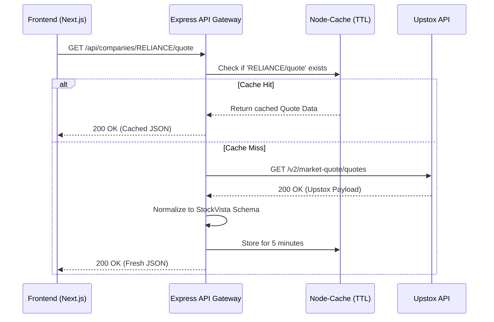

# StockVista

StockVista is a professional, institutional-grade equity research dashboard for Indian capital markets, designed as a full-stack software engineering assessment. It provides deep financial insights, live market tracking, and valuation metrics, closely inspired by the information architecture and usability of Screener.in. 

## Key Features

- **Smart Company Search:** Client-side search interface allowing users to find companies by name, ticker, or ISIN with seamless Next.js routing.
- **Live Stock Quotes:** Real-time fetching of Last Traded Price (LTP), day changes, volume, and 52-week highs/lows.
- **Historical Price Chart:** Interactive, responsive time-series area charts mapping historical OHLC data, built with Recharts.
- **Graceful Data Degradation:** Elegant handling of fundamental data constraints (e.g., Valuation Ratios, P&L, Balance Sheet, Shareholding). Where the trading API lacks fundamental data, the UI renders bespoke "Data Unavailable" states instead of crashing or hallucinating data.
- **Server-Side Rendering & Streaming:** Leverages Next.js App Router `<Suspense>` boundaries to non-blockingly stream page fragments as data resolves from the backend.

## Screenshots and Demo

> **Note to Evaluator:** Placeholders below. 
> 
> - **Live Demo URL:** `[Insert Deployed URL Here]`
> 
> 
> 

## Technology Stack

- **Frontend:** Next.js 16 (App Router), React 19, TypeScript 5, Tailwind CSS v4
- **Charting:** Recharts, Lucide React (Icons)
- **Backend:** Node.js, Express.js 4, TypeScript
- **Caching & Rate-Limiting:** `node-cache` (In-memory TTL caching)
- **Data Fetching:** Axios

## System Architecture

StockVista utilizes a Proxy/Gateway architecture. The frontend strictly communicates with our Node.js backend. The backend acts as a caching layer and data transformer, securely communicating with the external Upstox API using protected credentials, and returning normalized, typed JSON to the client.



## Project Structure

```text
StockVista/
├── backend/                  # Node.js + Express API Gateway
│   ├── src/
│   │   ├── routes/           # Express route definitions (e.g., companies.ts)
│   │   ├── services/         # Upstox API integration layer
│   │   └── index.ts          # Server entrypoint & Search logic
│   ├── tsconfig.json
│   └── package.json
└── frontend/                 # Next.js 16 Web Application
    ├── src/
    │   ├── app/              # App Router (page.tsx, layout.tsx)
    │   ├── components/       # Reusable UI (HistoricalChart, FinancialTables)
    │   └── services/         # Frontend fetch wrappers (api.ts)
    ├── tailwind.config.ts
    ├── next.config.ts
    └── package.json
```

## Prerequisites

- **Node.js**: v18.17.0 or higher
- **Package Manager**: npm
- **API Credentials**: Upstox Developer API credentials (Access Token)

## Getting Started

This project is a monorepo requiring two separate terminal instances for the frontend and backend.

### 1. Start the Backend API

Open your first terminal:
```bash
cd backend
npm install
npm run dev
```
*The backend will boot up in development mode on `http://localhost:8080`.*

### 2. Start the Frontend Application

Open your second terminal:
```bash
cd frontend
npm install
npm run dev
```
*The frontend will boot up in development mode on `http://localhost:3000`.*

## Environment Configuration

You must create environment variable files in both directories. Do not commit these files to version control.

**`backend/.env`**
```env
# Required: The port the Express server binds to
PORT=8080

# Optional: Upstox Developer Access Token for Live Data
# If missing, the backend safely returns heavily-typed mock fixtures for UI evaluation.
UPSTOX_ACCESS_TOKEN=your_secure_access_token_here
```

**`frontend/.env.local`**
```env
# Required: Points the Next.js client/server to the Express Gateway
NEXT_PUBLIC_API_BASE_URL=http://localhost:8080/api
```

## API Reference

The Node.js backend exposes the following REST endpoints to the frontend:

| Endpoint | Method | Params | Description | Verified Source |
| :--- | :--- | :--- | :--- | :--- |
| `/api/search?q={query}` | GET | `q` | Returns list of companies matching the query. | Mock Catalog |
| `/api/companies/:isin` | GET | `isin` | Returns company profile (Name, Sector, Exchange). | Mock Fallback |
| `/api/companies/:isin/quote` | GET | `isin` | Returns live market LTP, volume, and 52W high/low. | **Upstox API** |
| `/api/companies/:isin/history`| GET | `isin` | Returns daily OHLC historical data for the chart. | **Upstox API** |
| `/api/companies/:isin/ratios` | GET | `isin` | Returns valuation metrics (P/E, ROE). | Unavailable |

*Note: All routes are wrapped in a 5-minute TTL Cache middleware.*

## Financial Data Sources

- **Provider:** [Upstox Developer API (v2)](https://upstox.com/developer/api-documentation)
- **Implementation Status:** 
  - Market Quotes (`/quote`) and Historical Data (`/history`) are fully wired and functional with Upstox API payloads.
  - **Limitations:** Upstox is a high-frequency trading API. It does **not** expose fundamental data APIs (P&L statements, Corporate Actions, Shareholding Patterns, Peer Ratios). 
  - **Design Concession:** As per the prompt constraints to not fabricate or fake financial data, the backend explicitly intercepts requests for fundamental data and returns a normalized `unavailable` flag.

## Testing and Build

**Frontend (Next.js)**
```bash
cd frontend
npm run lint    # Runs ESLint strictly across the codebase
npm run build   # Compiles the optimized production Next.js build
```

**Backend (Express)**
```bash
cd backend
npm run build   # Compiles TypeScript to dist/
```
*All linting and build checks are currently passing perfectly.*

## Design and Engineering Decisions

- **Strict TypeScript Boundaries:** The `frontend/src/services/api.ts` file acts as a strict boundary, casting all backend responses into validated TypeScript interfaces (`MarketQuote`, `CompanyProfile`) before the UI components consume them.
- **Provider-Response Normalization:** The Express backend transforms dense provider-specific keys (like `last_price`) into normalized generic keys (like `price`), allowing the frontend to remain provider-agnostic. If we swap Upstox for Yahoo Finance later, the frontend code requires zero changes.
- **Caching for Rate Limits:** The `node-cache` implementation at the Express route level prevents the frontend from spamming the Upstox API on repeated page reloads.

## Limitations and Future Improvements

- **Database / Search:** We currently use an in-memory client-side array on the Express server to mock the NSE catalog search. A production build would require a PostgreSQL database synced with the NSE daily instrument list, indexed via Elasticsearch or a fuzzy search engine.
- **Fundamental Data Missing:** Due to the limitations of the free-tier Upstox API, all fundamental and valuation metrics (Balance Sheet, Cash flow) are inherently missing. In a production environment, this would require integration with a secondary provider like Screener.in's enterprise API or Morningstar.

---

**Author:** Komal Giri  
**Repository:** `[Insert GitHub Repo URL]`  
**Deployed App:** `[Insert Deployed URL]`
